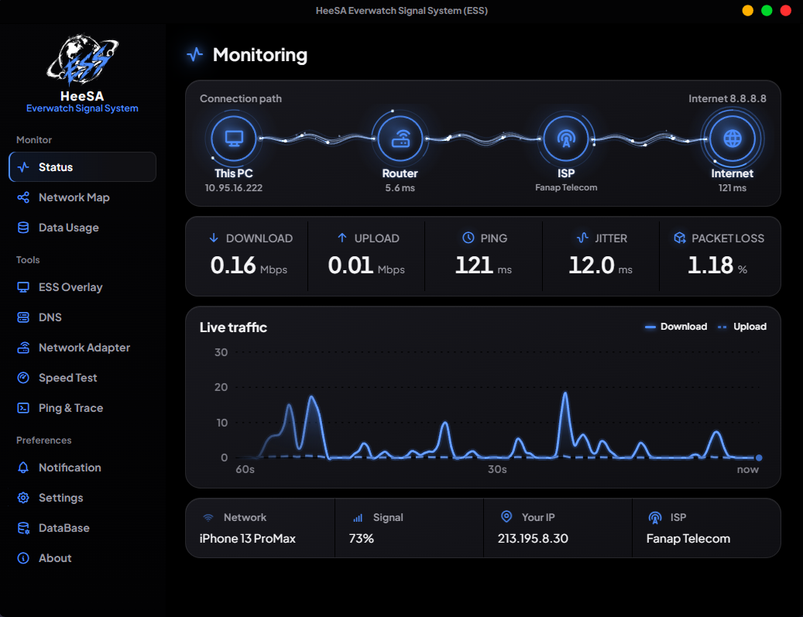
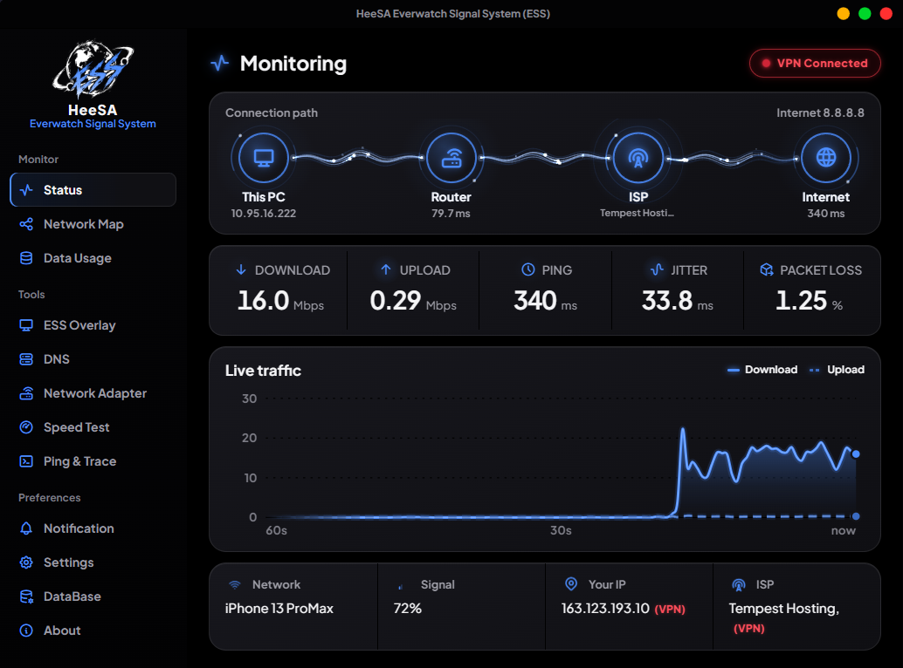
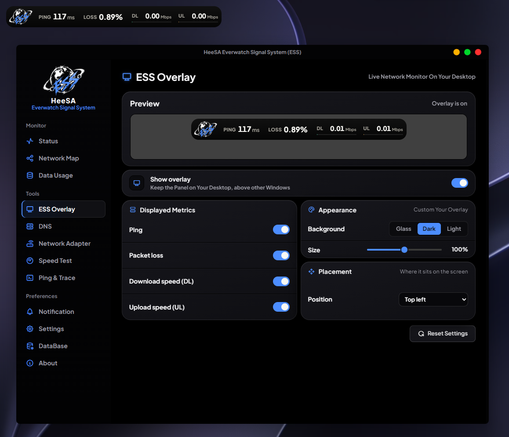
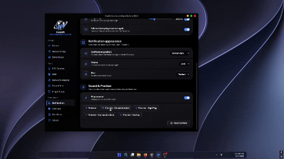
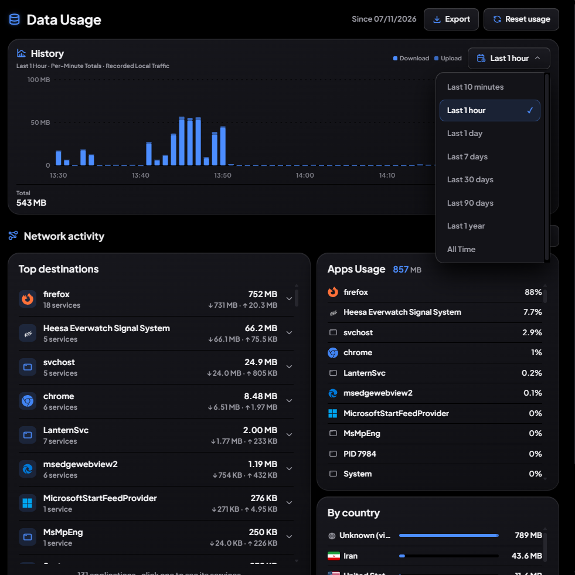
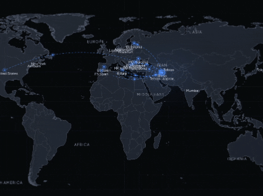
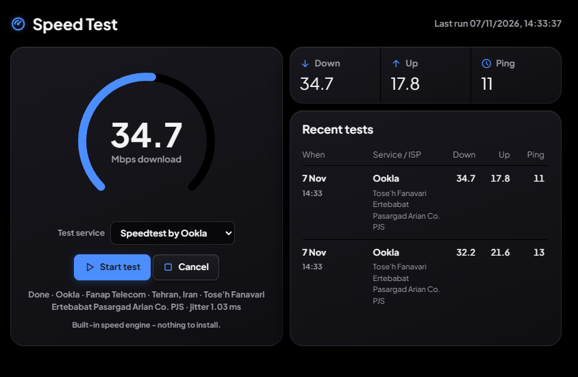
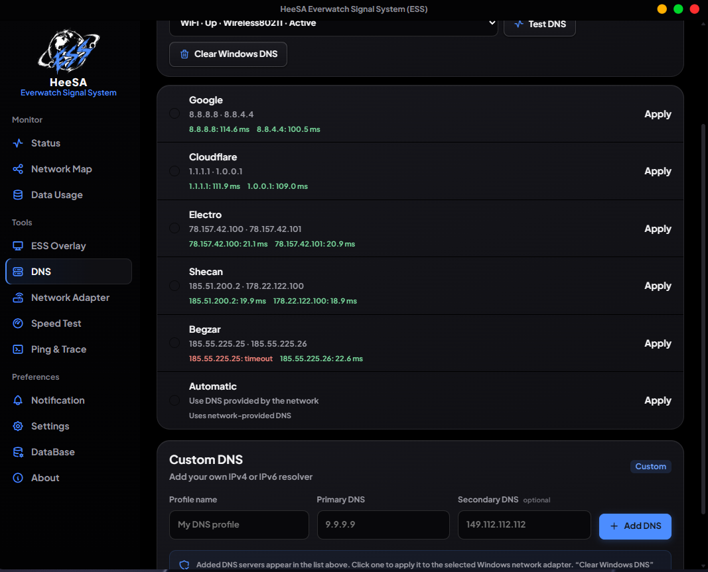
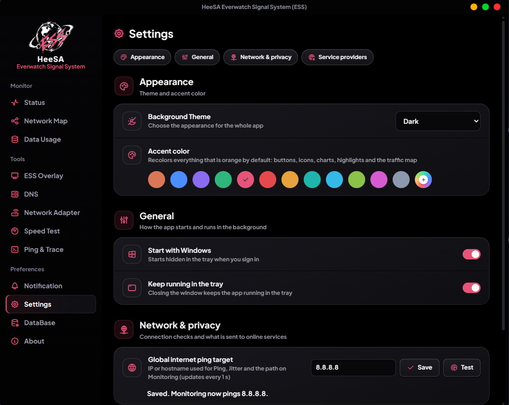

<div align="center">

# Heesa Everwatch Signal System (ESS)

### سامانه رایگان پایش شبکه برای ویندوز

<br>

<a href="./README.md"></a>
&nbsp;
<a href="./README.fa.md"></a>

<br><br>


<br>

[**⬇️ دانلود آخرین نسخه**](https://github.com/HeeSASoftware/ESS-Network-Monitoring-System/releases/latest)

<br>

[✨ امکانات](#features) · [🧭 نحوه کار](#how-it-works) · [🚀 شروع سریع](#getting-started) · [🗂️ ساختار پوشه‌ها](#folder-layout) · [🛡️ پایداری](#reliability) · [📬 ارتباط](#contact)

</div>

---

<div dir="rtl" align="right">

<a id="what-is-ess"></a>

## 🌌 ESS چیست؟

**HeeSA Everwatch Signal System (ESS)** یک مانیتور شبکه‌ی حرفه‌ای برای ویندوز است، مخصوص کسانی که پاسخ دقیق درباره‌ی اینترنتشان می‌خواهند.

ESS مقدار **پینگ، جیتر، پکت‌لاس، سرعت دانلود و آپلود** را روی **کارت شبکه‌ی فیزیکی واقعی** اندازه می‌گیرد، لحظه‌ی قطع شدن اینترنت به شما هشدار می‌دهد، نشان می‌دهد **کدام برنامه‌ها و مقصدها** از دیتای شما استفاده می‌کنند و یک اورلی تمیز روی صفحه نگه می‌دارد.

<h2 align="center">👁️ پیش‌نمایش</h2>

<p align="center">
  <a href="https://heesasoftware.github.io/ESS-Network-Monitoring-System/"></a>
</p>

<p align="center">
  <a href="https://heesasoftware.github.io/ESS-Network-Monitoring-System/"></a>
</p>

<details>
<summary><b>🔽 &nbsp;پیش‌نمایش‌های سریع</b> &nbsp;<i>(برای باز شدن کلیک کنید)</i></summary>

<br>

<details>
<summary>📡 &nbsp;Status (وضعیت)</summary>
<br>
<p align="center">
  
</p>
</details>

<details>
<summary>🛡️ &nbsp;VPN Mode (حالت VPN)</summary>
<br>
<p align="center">
  
</p>
</details>

<details>
<summary>🖥️ &nbsp;اورلی در حال کار</summary>
<br>
<p align="center">
  
</p>
</details>

<details>
<summary>🔔 &nbsp;هشدارهای هوشمند (GIF)</summary>
<br>
<p align="center">
  
</p>
</details>

<details>
<summary>📈 &nbsp;مصرف دیتا</summary>
<br>
<p align="center">
  
</p>
</details>

<details>
<summary>🗺️ &nbsp;نقشه‌ی جهانی ترافیک (GIF)</summary>
<br>
<p align="center">
  
</p>
</details>

<details>
<summary>🚀 &nbsp;تست سرعت</summary>
<br>
<p align="center">
  
</p>
</details>

<details>
<summary>🔎 &nbsp;DNS</summary>
<br>
<p align="center">
  
</p>
</details>

<details>
<summary>⚙️ &nbsp;تنظیمات</summary>
<br>
<p align="center">
  
</p>
</details>

</details>

---

<a id="features"></a>

## ✨ امکانات

### 📡 پایش زنده

| | معیار | توضیح |
|---|---|---|
| ⚡ | **پینگ (Ping)** | روی کارت شبکه‌ی واقعی و بدون تایم‌اوت کاذب |
| 🌊 | **جیتر (Jitter)** | تحلیل لحظه‌ای جیتر |
| 📉 | **پکت‌لاس (Packet Loss)** | نمایش لحظه‌ای افت بسته‌ها |
| ⬇️⬆️ | **دانلود / آپلود** | سرعت لحظه‌ای دانلود و آپلود |
| 🌐 | **IP و ISP** | نمایش واضح IP فعلی و ارائه‌دهنده‌ی اینترنت |

### 🖥️ اورلی ESS

- 📌 همیشه روی بقیه‌ی پنجره‌ها، **حتی بالای برنامه‌های تمام‌صفحه**
- 🔄 همراه با اجرای برنامه، خودکار نمایش داده می‌شود
- 🎛️ تنظیمات زنده با **ذخیره‌ی خودکار**، بدون دکمه‌ی Save / Apply / Discard
- 🎮 پینگ سرور بازی بدون قطعی کاذب

### 🔔 هشدارهای هوشمند

- 🚨 **تشخیص آنی قطع شدن اینترنت**
- 🔁 هشدار سریع **قطع، وصل مجدد و پینگ بالا**
- 🔊 صداهای هشدار، با ظاهر روشن و تیره

### 📊 مصرف دیتا

- 🧩 مصرف **به تفکیک برنامه**، **مقصد** و **کشور**
- ✅ فقط **ترافیک واقعی**، با تشخیص هوشمند ترافیک جعلی
- 🗓️ نگهداری تاریخچه تا **۵ سال**
- 🛰️ **سرویس ESS** حتی وقتی برنامه بسته است، در پس‌زمینه ثبت می‌کند

### 🗺️ نقشه‌ی جهانی ترافیک

- 🌍 *Global Traffic Map by HeeSA* با پایگاه‌داده‌ی آفلاین شبکه

### 🕵️ IP · ISP · موقعیت مکانی

- 🎯 تشخیص IP با **ipmyp.ir**، **ipapi.co** و **ipinfo.co**
- ☁️ ترکیب Cloudflare trace با پایگاه‌داده‌ی آفلاین شبکه
- 🔒 طراحی‌شده با تمرکز بر حریم خصوصی IP و حفاظت از اتصال

### 🧱 تشخیص VPN / Proxy

- 🛡️ شناسایی ابزارهای VPN و پروکسی (مثل Lantern و کلاینت‌های نوع v2ray)
- ⏳ تشخیص دقیق کلاینت‌های VPN و پروکسی
- 🧾 گزارش آنی وضعیت اتصال

### 🧰 ابزارها

- 🚀 **تست سرعت**: Cloudflare و Speedtest by Ookla
- 🧭 **Ping & Trace**: ترسروت کامل با نتایج واقعی هر هاپ

### 🎨 تم‌ها

- 🌑 **تیره (Dark)** · ☀️ **روشن (Light)** · 🪟 **شیشه‌ای (Glass)** با Acrylic / Mica واقعی ویندوز

---

<a id="how-it-works"></a>

## 🧭 نحوه کار

</div>

<div dir="ltr">

```text
                ┌──────────────────┐
                │ Network Adapter  │
                └────────┬─────────┘
                         │
                         ▼
                ┌──────────────────┐
                │    ESS Engine    │
                │ DL/UL/Ping/Loss  │
                └────────┬─────────┘
                         │
            ┌────────────┴────────────┐
            ▼                         ▼
   ┌──────────────────┐      ┌──────────────────┐
   │ Overlay · Alerts │      │   ESS Service    │
   │ Monitoring · UI  │      │  Data Usage DB   │
   └──────────────────┘      │ Background       │
                             │ Traffic Recorder │
                             └──────────────────┘
```

</div>

<div dir="rtl" align="right">

---

<a id="getting-started"></a>

## 🚀 شروع سریع

1. 📥 آخرین نصاب را از صفحه‌ی [Releases](https://github.com/HeeSASoftware/ESS-Network-Monitoring-System/releases/latest) دانلود کنید، محل نصب را انتخاب کنید و فایل EXE را اجرا کنید.
2. ▶️ برنامه‌ی **HeeSA Everwatch Signal System.exe** را باز کنید.
3. 🔐 توضیحات صفحه‌ی **«Yes, Enable»** را بخوانید و برای ادامه تأیید کنید.
4. 🟢 گزینه‌های **Start with Windows** و **Keep running in the tray** را فعال کنید تا ESS از لحظه‌ی بوت ویندوز شبکه را زیر نظر داشته باشد.

**پیش‌نیازها**

- 🪟 ویندوز ۱۰ یا ۱۱ (۶۴ بیتی)
- 🌐 **WebView2 Runtime** مایکروسافت اج (نسخه‌ی Evergreen)

---

<a id="folder-layout"></a>

## 🗂️ ساختار پوشه‌ها

</div>

<div dir="ltr">

```text
HeeSA Everwatch Signal System/
├── 🚀 HeeSA Everwatch Signal System.exe
├── 🗑️ Uninstall ESS.exe
└── …clean, grouped support folders
```

</div>

<div dir="rtl" align="right">

---

<a id="reliability"></a>

## 🛡️ پایداری و اطمینان

- 🪵 یک لاگ کرش یکپارچه (`ESS Crash Log.log`) همراه با نمایشگر **Crash Log.exe**
- 🩺 ابزار داخلی **Run diagnosis** و امکان خروجی گرفتن از گزارش کرش
- 🧹 حذف تمیز با **Uninstall ESS.exe**

---

<a id="contact"></a>

## 📬 ارتباط

| | |
|---|---|
| 💬 کانال تلگرام | [@HeeSA_Software](https://t.me/HeeSA_Software) |
| 🐙 گیت‌هاب | [@HeeSASoftware](https://github.com/HeeSASoftware) |

</div>

---

<div align="center">

**ساخته‌شده با 💙 توسط HeeSA**

⭐ اگر ESS به دردتان خورد، به پروژه ستاره بدهید!

</div>
