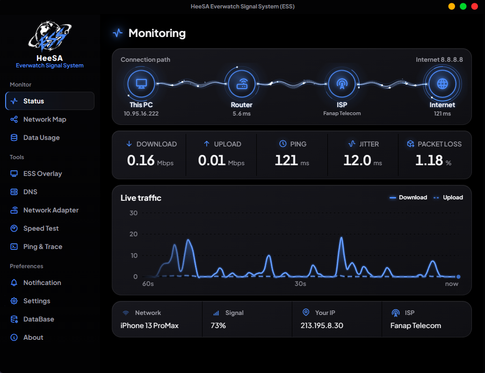
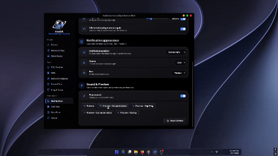
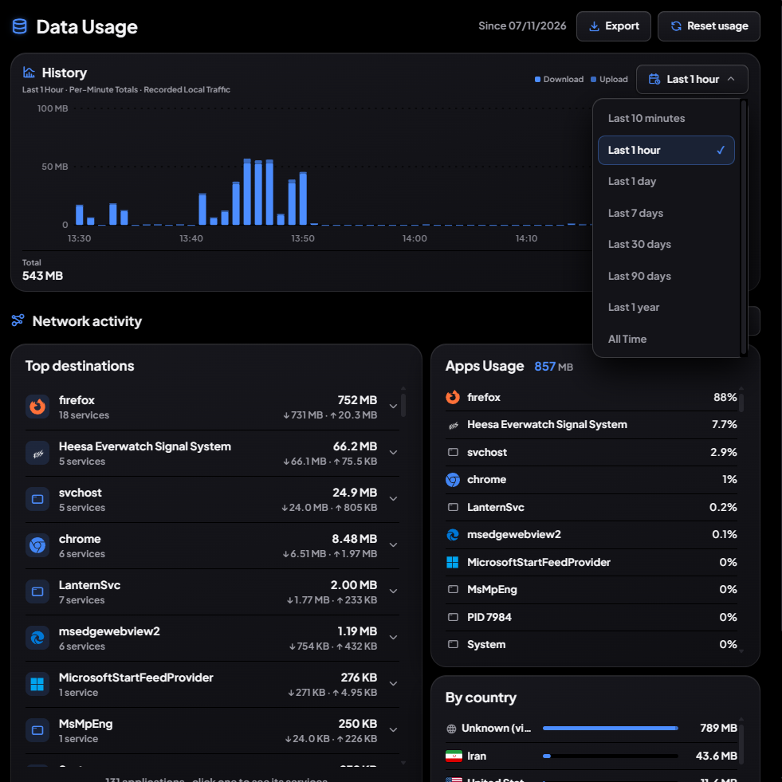
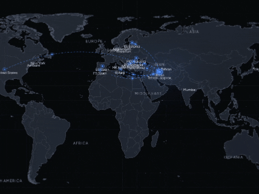
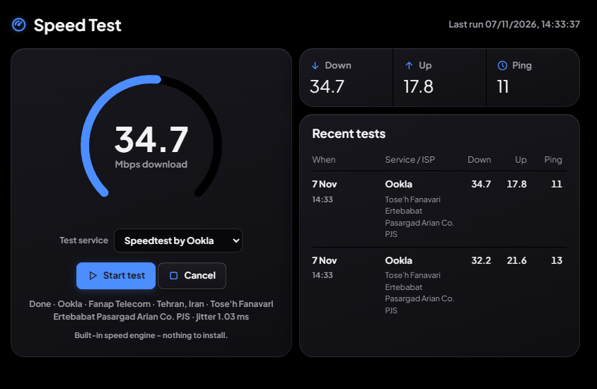
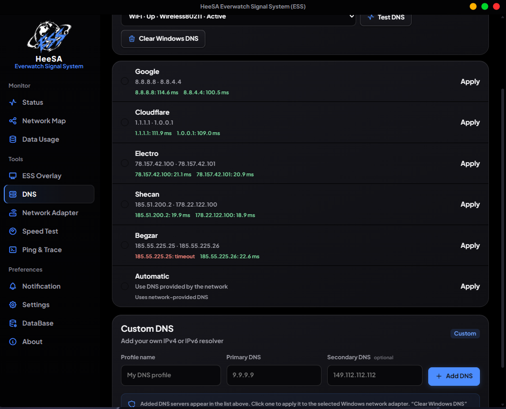
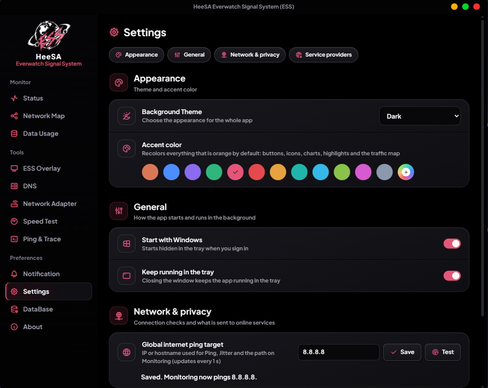

<div align="center">

# Heesa Everwatch Signal System (ESS)

### Free Network Monitoring System For Windows

<br>


<br>

[**⬇️ Download latest release**](https://github.com/HeeSASoftware/ESS-Network-Monitoring-System/releases/latest)

<br>

[✨ Features](https://github.com/HeeSASoftware/ESS-Network-Monitoring-System#features) · [🧭 How it works](https://github.com/HeeSASoftware/ESS-Network-Monitoring-System#how-it-works) · [🚀 Getting started](https://github.com/HeeSASoftware/ESS-Network-Monitoring-System#getting-started) · [🗂️ Folder layout](https://github.com/HeeSASoftware/ESS-Network-Monitoring-System#folder-layout) · [🛡️ Reliability](https://github.com/HeeSASoftware/ESS-Network-Monitoring-System#reliability) · [📬 Contact](https://github.com/HeeSASoftware/ESS-Network-Monitoring-System#contact)

</div>

---

<a id="what-is-ess"></a>
## 🌌 What is ESS?

**HeeSA Everwatch Signal System (ESS)** is a premium Windows network monitor for people who need accurate answers about their connection.

It measures **ping, jitter, packet loss, download and upload speed** on the **real physical adapter**, alerts you the moment the internet drops, shows **which apps and destinations** use your data, and keeps a clean overlay on your screen.

<details>
<summary><b>🖼️ Screenshots & Preview </b> &nbsp;·&nbsp; click to open</summary>

<br>

<details>
<summary>📡 &nbsp;Status</summary>
<br>
<p align="center">
  
</p>
</details>


<details>
<summary>🛡️ &nbsp;VPN MODE</summary>
<br>
<p align="center">
  
</p>
</details>

<details>
<summary>🖥️ &nbsp;Overlay in action </summary>
<br>
<p align="center">
  
</p>
</details>

<details>
<summary>🔔 &nbsp;Smart Alerts (GIF)</summary>
<br>
<p align="center">

</p>
</details>

<details>
<summary>📈 &nbsp;Data usage</summary>
<br>
<p align="center">
  
</p>
</details>

<details>
<summary>🗺️ &nbsp;Global traffic Map(GIF)</summary>
<br>
<p align="center">
  
</p>
</details>

<details>
<summary>🚀 &nbsp;Speed test </summary>
<br>
<p align="center">
  
</p>
</details>

<details>
<summary>🔎 &nbsp;DNS </summary>
<br>
<p align="center">
  
</p>
</details>

<details>
<summary>⚙️ &nbsp;Settings</summary>
<br>
<p align="center">
  
</p>
</details>

</details>

---

<a id="features"></a>
## ✨ Features

### 📡 Live Monitoring

| | Metric | Details |
|---|---|---|
| ⚡ | **Ping** | Measured on the real network adapter, with no false timeouts |
| 🌊 | **Jitter** | Real-time jitter analysis |
| 📉 | **Packet loss** | Real-time loss metrics |
| ⬇️⬆️ | **Download / Upload** | Real-time speed metrics |
| 🌐 | **IP & ISP** | Clear view of your current IP and your ISP |

### 🖥️ ESS Overlay

- 📌 Always on top, **even above fullscreen apps**
- 🔄 Appears automatically when the app starts
- 🎛️ Live settings with **auto-save**, no Save / Apply / Discard buttons
- 🎮 Game-server latency without false disconnects

### 🔔 Smart Alerts

- 🚨 **Instant disconnect detection**
- 🔁 Fast alerts for **disconnect, reconnect and high ping**
- 🔊 Alert sounds, in light and dark styles

### 📊 Data Usage

- 🧩 Break down usage **by application**, **by destination** and **by country**
- ✅ **Real traffic only**, with smart detection of fake traffic
- 🗓️ History stored for up to **5 years**
- 🛰️ **ESS Service** keeps recording in the background, even when the app is closed

### 🗺️ Global Traffic Map

- 🌍 *Global Traffic Map by HeeSA*, powered by an offline network database

### 🕵️ IP · ISP · Location

- 🎯 IP detection via **ipmyp.ir**, **ipapi.co** and **ipinfo.co**
- ☁️ Cloudflare trace combined with the offline network database
- 🔒 Built with IP privacy and connection protection in mind

### 🧱 VPN / Proxy Detection

- 🛡️ Detects VPN and proxy tools (for example Lantern and v2ray-type clients)
- ⏳ Accurate identification of VPN and proxy clients
- 🧾 Instant connection reports

### 🧰 Tools

- 🚀 **Speed Test**: Cloudflare and Speedtest by Ookla
- 🧭 **Ping & Trace**: full traceroute with real hop results

### 🎨 Themes

- 🌑 **Dark** · ☀️ **Light** · 🪟 **Glass** (real Windows Acrylic / Mica)

---

<a id="how-it-works"></a>
## 🧭 How it works

```
                ┌──────────────────┐
                │  Network Adapter │
                └────────┬─────────┘
                         │
                         ▼
                ┌──────────────────┐
                │    ESS Engine    │
                │ DL/UL/Ping/Loss  │
                └────────┬─────────┘
                         │
            ┌────────────┴────────────┐
            ▼                         ▼
   ┌──────────────────┐      ┌──────────────────┐
   │ Overlay · Alerts │      │   ESS Service    │
   │ Monitoring · UI  │      │  Data Usage DB   │
   └──────────────────┘      │ Background       │
                             │ Traffic Recorder │
                             └──────────────────┘
```

---

<a id="getting-started"></a>
## 🚀 Getting started

1. 📥 Download the latest installer from the [Releases](https://github.com/HeeSASoftware/ESS-Network-Monitoring-System/releases/latest) page, choose an install location and run the EXE.
2. ▶️ Launch **HeeSA Everwatch Signal System.exe**.
3. 🔐 Read the information on the **"Yes, Enable"** screen and confirm to continue.
4. 🟢 Turn on **Start with Windows** and **Keep running in the tray** so ESS watches your network from boot.

**Requirements**

- 🪟 Windows 10/11 64x
- 🌐 Microsoft Edge **WebView2 Runtime** (Evergreen)

---

<a id="folder-layout"></a>
## 🗂️ Folder layout

```text
HeeSA Everwatch Signal System/
├── 🚀 HeeSA Everwatch Signal System.exe
├── 🗑️ Uninstall ESS.exe
└── …clean, grouped support folders
```

---

<a id="reliability"></a>
## 🛡️ Reliability

- 🪵 One unified crash log (`ESS Crash Log.log`) with a **Crash Log.exe** viewer
- 🩺 Built-in **Run diagnosis** and exportable crash reports
- 🧹 Clean removal with **Uninstall ESS.exe**

---

<a id="contact"></a>
## 📬 Contact

| | |
|---|---|
| 💬 Telegram channel | [@HeeSA_Software](https://t.me/HeeSA_Software) |
| 🐙 GitHub | [@HeeSASoftware](https://github.com/HeeSASoftware) |

---

<div align="center">

**Made with 💙 by HeeSA**

⭐ If ESS is useful to you, give the project a star!

</div>
